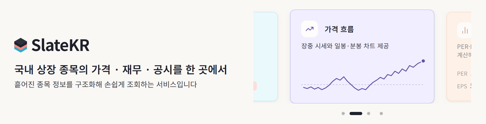
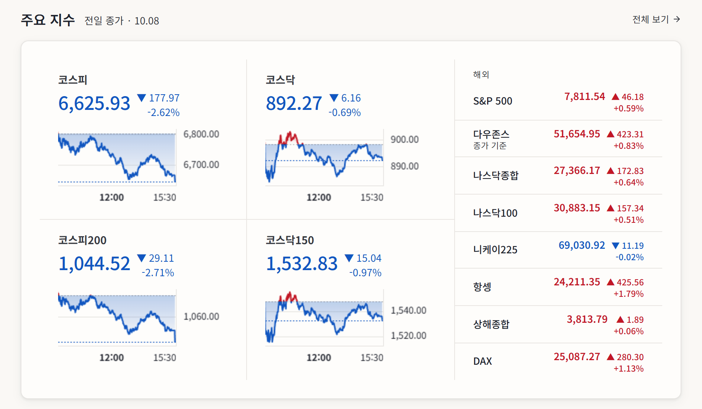
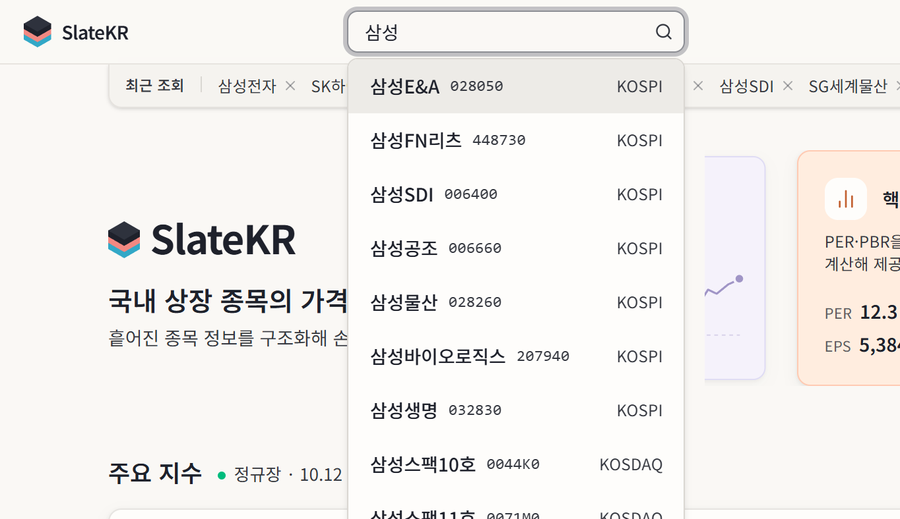
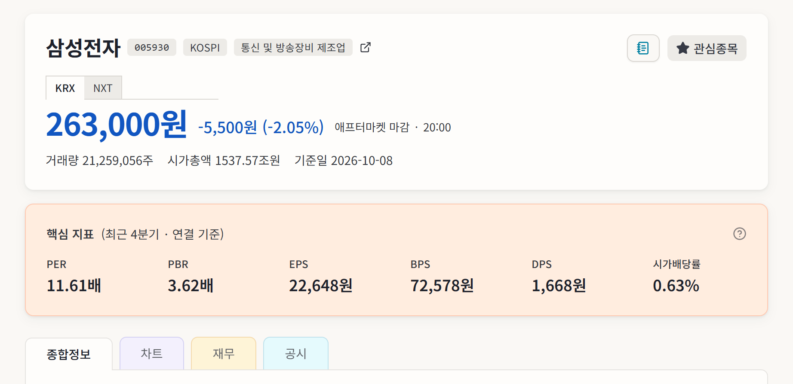
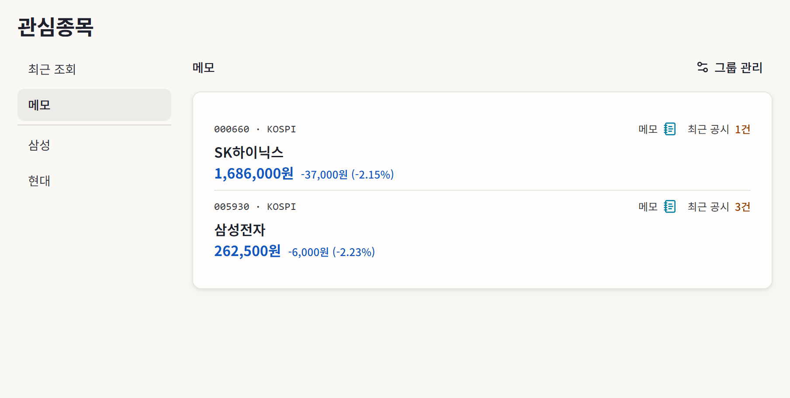
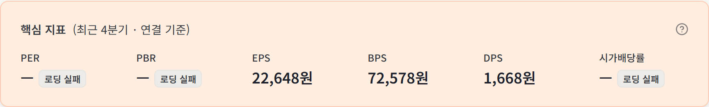
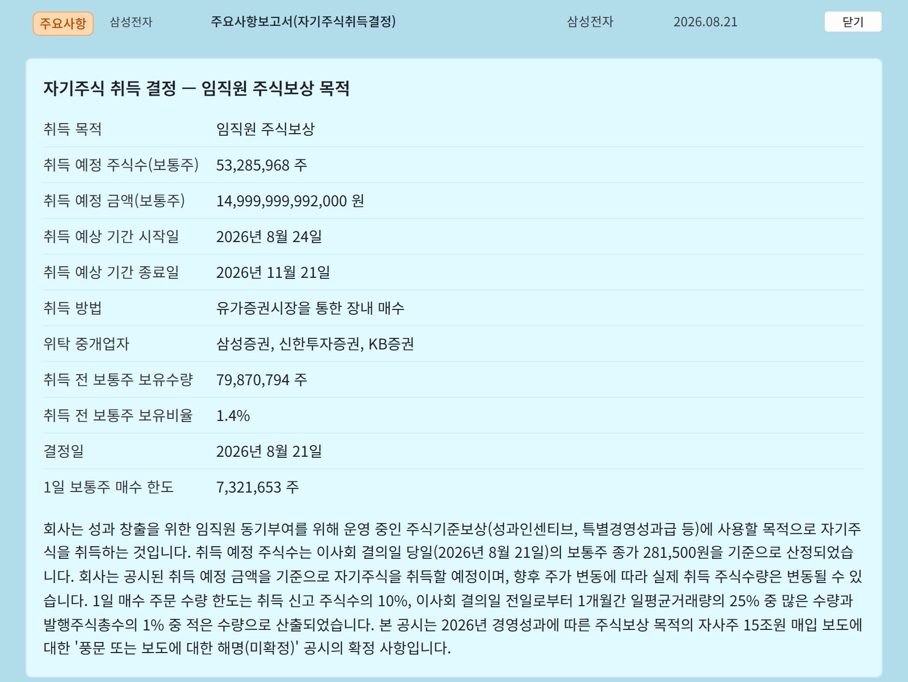
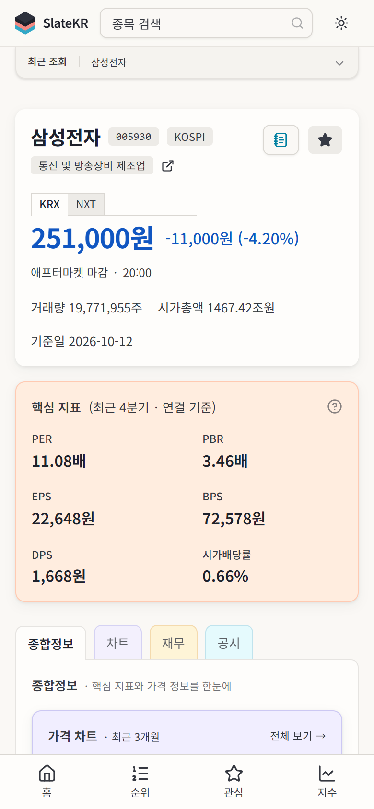

<div align="center">

# SlateKR

국내 상장 종목의 가격 · 재무 · 공시와 국내·해외 주요 지수를 조회하는 웹앱

**캐시 계층 · 부분 실패 UI · 런타임 검증 · 익명 동기화**

[](https://github.com/Donghunn-Lee/slate-kr/actions/workflows/web-ci.yml) [](https://github.com/Donghunn-Lee/slate-kr/actions/workflows/collector-ci.yml)       

[**Live**](https://slate-kr.vercel.app) &nbsp;·&nbsp; 2026.04 – 2026.10 &nbsp;·&nbsp; 1인 개발

</div>



## 한눈에 보기

<table>
  <thead>
    <tr>
      <th nowrap>주제</th>
      <th>한 일</th>
      <th nowrap>설계 결정</th>
    </tr>
  </thead>
  <tbody>
    <tr>
      <td nowrap>캐시 계층</td>
      <td>route 캐시로 지수 · 순위 route의 KIS(한국투자증권 OpenAPI) 호출 수를 사용자 수와 분리. 실패 응답이 캐시에 남는 문제는 감지 즉시 무효화</td>
      <td nowrap><a href="#1-갱신-전략">1. 갱신 전략</a></td>
    </tr>
    <tr>
      <td nowrap>부분 실패 UI</td>
      <td>종목 상세를 섹션 단위 Suspense로 스트리밍하고, 섹션마다 loading · empty · error · 부분 실패를 구분</td>
      <td nowrap><a href="#2-장애-격리와-폴백">2. 장애 격리와 폴백</a></td>
    </tr>
    <tr>
      <td nowrap>런타임 검증</td>
      <td>외부 API 응답 · JSONB 스냅샷 · 요청 바디를 Zod로 검증. AI 요약은 Zod 스키마 하나로 요청 스키마 생성과 응답 검증을 공유</td>
      <td nowrap><a href="#3-런타임-검증-ai-공시-요약">3. 런타임 검증: AI 공시 요약</a></td>
    </tr>
    <tr>
      <td nowrap>익명 동기화</td>
      <td>로그인 없이 쿠키 2개로 브라우저를 식별해 관심종목을 JSONB 1행으로 서버 저장</td>
      <td nowrap><a href="#4-익명-동기화">4. 익명 동기화</a></td>
    </tr>
  </tbody>
</table>

## 주요 화면

<table>
  <tr>
    <td width="50%" align="center">
      <b>홈</b><br>
      국내 4 · 해외 8 지수를 장중 갱신<br>
      
    </td>
    <td width="50%" align="center">
      <b>검색</b><br>
      300ms debounce · 요청 취소 · 키보드 탐색<br>
      
    </td>
  </tr>
  <tr>
    <td width="50%" align="center">
      <b>종목 상세</b><br>
      가격 통계 · 차트 · 핵심 지표 · 5년 재무 · 공시<br>
      
    </td>
    <td width="50%" align="center">
      <b>관심종목 · 메모</b><br>
      그룹 · 메모 · 로그인 없는 서버 저장<br>
      
    </td>
  </tr>
</table>

UI는 정보 단위마다 독립 패널을 두는 "슬레이트(판)" 구조이고, 공시 · 가격 · 재무 · 차트 · 지표에 semantic 컬러 5색을 씁니다. 토큰과 컴포넌트는 [`/styleguide`](https://slate-kr.vercel.app/styleguide)에 먼저 등재한 뒤 그 기준으로 구현했고, shadcn은 Dialog · Popover · Tabs 같은 상호작용 primitive에만 쓰고 표시 컴포넌트는 토큰 기반으로 직접 구현했습니다.

## 배경

SlateKR은 외부 데이터를 조합하고, 캐시하고, 장애를 드러내면서 화면을 유지하는 쪽을 다룹니다. 사용자 흐름은 검색 → 종목 상세 → 관심종목 저장이고, 투자 추천 · 분석 기능은 범위 밖입니다.

## 아키텍처

```
DB / 외부 API
  → lib/            조회 + 정규화 (순수 함수 · Zod 검증)
    → shared/types/ 도메인 모델
      → UI          도메인 모델만 소비
```

`lib/`의 정규화 레이어가 경계입니다. DB Row 타입과 외부 API 응답 타입은 이 경계를 넘지 않습니다. route 파일 안의 SQL은 0건이고, UI의 DB Row · 외부 API 타입 import도 0건입니다. Zod 검증 대상은 외부 API 응답 · JSONB 스냅샷 · 요청 바디입니다. 외부 API 응답이 검증에 실패하면 KIS는 조회 실패(`null`)로, DART 공시 목록은 오류로 처리해 각 섹션의 실패 경로를 탑니다.

<details>
<summary>디렉토리 구조</summary>

```
web/src/
├── app/         라우트 · layout · loading / error / not-found
├── features/    검색 · 관심종목 · 메모 등 사용자 액션 단위
├── entities/    종목 · 공시 · 지표 · 지수 등 도메인 표시 단위
├── shared/      도메인 타입 · 상수 · 포맷터 · 범용 유틸
├── lib/         DB 조회 · 정규화 · 서버 유틸
└── components/ui/  shadcn 기반 primitive
collector/       Python 수집 스크립트
web/sql/         DDL · 데이터 보정 · 캐시 리셋 SQL (Neon 콘솔 수동 적용, 파일로 추적)
```

</details>

| 데이터 | 위치 | 이유 |
|---|---|---|
| 종목 기본 정보 · 재무 · 공시 · 일봉 데이터 | Server Component(요청 시 서버 렌더) | 읽기 전용, 검색 노출 |
| 시세 · 분봉(종목 · 지수) | Client + TanStack Query | 장 세션별 폴링 주기, 탭 복귀 처리 |
| 관심종목 · 메모 · 최근 조회 | Zustand persist + 익명 서버 스냅샷 | 사용자 소유 데이터, 로그인 없음 |

종목 상세 전 페이지에 `generateMetadata`를 두고, sitemap은 활성 종목 약 2,650개를 하루 1회 재생성합니다.

`use client`는 이벤트 · 브라우저 API · 차트 · 입력 UI에만 씁니다. page 파일은 전부 Server Component이고, 관심종목 · 순위처럼 데이터가 브라우저 스토어나 폴링에 있는 화면은 본문이 client 컴포넌트 하나입니다.

Route Handler 15개는 외부 API 실패를 가능한 한 200과 `failed` 플래그로 내려, 클라이언트가 직전 값과 세션 라벨을 유지하게 합니다.

### Tech Stack

| 영역 | 구성 |
|---|---|
| Frontend | Next.js 16 App Router · TypeScript strict · Tailwind CSS v4 · shadcn/ui · TanStack Query v5 · Zustand · lightweight-charts v5 · Zod |
| Infra | Neon PostgreSQL · Vercel · GitHub Actions · cron-job.org |
| Data | Python collector · KIS OpenAPI · DART OpenAPI · FSS API · KRX Marketplace |
| AI · Test | Gemini API · Vitest |

## 설계 결정

### 1. 갱신 전략

KIS API는 초당 호출 한도가 있고, 홈 한 화면이 지수 12셀을 장중에 갱신합니다. route 캐시로 요청을 병합해 지수 · 순위 route의 KIS 호출 수를 사용자 수와 분리하는 것이 목표였습니다.

- 페이지 층: 페이지 캐시(ISR)는 홈 1시간 하나입니다. 종목 상세 · 지수 · 순위 · 검색은 요청 시 서버 렌더이고, 캐시는 데이터 단위로 둡니다. Next.js 16의 `cacheComponents`와 `use cache`는 캐시 계층 전체를 다시 설계해야 해 쓰지 않았습니다.
- route 층: 지수 · 순위 Route Handler는 `unstable_cache`를 씁니다. TTL은 세션에 따라 다릅니다. 장중에는 60초(해외 지수 분봉은 120초), 마감 직후 정산 구간에도 60초, 그 외에는 1시간입니다. 장중 60초는 클라이언트 폴링 주기에 맞춘 값이고, 정산 구간 60초는 늦게 들어오는 확정 값이 1시간 캐시에 굳지 않게 하는 값입니다. 캐시 route 응답에 HTTP 캐시 헤더는 두지 않습니다. 캐시가 서버 안에만 있어 응답 헤더의 `x-vercel-cache`는 MISS로 보입니다. 사용자 데이터 route만 `private, no-store`입니다.
- 실패 응답은 캐시에 남기지 않습니다. KIS 일시 장애 때 빈 차트가 TTL 동안 그대로 서빙된 결함에서 나온 규칙입니다. 조회 함수는 실패를 `null`로 반환하고 `unstable_cache`는 `null`도 저장하므로, 실패를 감지한 즉시 `revalidateTag`로 해당 항목을 무효화합니다(지수 quote · 분봉 4개 route와 순위 route). 빈 값(`[]`)과 실패(`null`)는 데이터 층에서 분리합니다.
- 데이터 층: DB 조회는 `React.cache`로 요청 안에서만 중복을 제거합니다. 이 층에서 시간 캐시를 쓰는 곳은 셋입니다: DART fetch `revalidate`(공시 목록 1시간 · 기업개황 1일), KIS 토큰 모듈 캐시, 장 캘린더 모듈 memo. 종목 상세의 DB 조회에 시간 캐시를 두지 않은 것은 장 마감 후 이전 종가가 최신처럼 보일 수 있어서이고, 적재 후 재검증 장치 없이는 도입하지 않았습니다.

<details>
<summary>"실시간" 표기를 내린 이유</summary>

초기 라벨은 "실시간"이었습니다. 종목 시세는 약 1분, 지수는 1~2분 주기의 폴링이므로 표기를 내렸습니다. 라벨은 장 세션 명칭(정규장 · 애프터마켓 · 마감 시각)으로 쓰고, 갱신 주기는 [`/credits`](https://slate-kr.vercel.app/credits)에 명시했습니다. 실시간은 KIS WebSocket과 상시 연결 서버가 필요한 별개 작업입니다.

</details>

<sub>코드 · [`session-cache.ts`](web/src/lib/session-cache.ts) · [`index-quotes/route.ts`](web/src/app/api/index-quotes/route.ts)</sub><br>
<sub>글 · [#075 실패 응답 캐시 결함](https://velog.io/@dh82680/SlateKR-075-intraday-실패-캐시-결함-해결) · [#140 "실시간" 표기 제거](https://velog.io/@dh82680/SlateKR-140-지수-라벨-규칙-통일과-실시간을-내린-이유) · [#155 120봉 API 전환](https://velog.io/@dh82680/SlateKR-155-코드로만-종결한-두-판정과-120봉-TR-전환) · [#174 선언만 있던 revalidate](https://velog.io/@dh82680/SlateKR-174-선언만-있던-revalidate와-한-달-멈춰-있던-차트-당일-봉)</sub>

### 2. 장애 격리와 폴백

종목 상세 한 페이지가 DB · DART · KIS 세 소스에 의존합니다. 초기 구현은 섹션별 `try-catch` 뒤 빈 배열 폴백이어서 페이지는 유지됐지만 빈 값과 조회 실패가 구분되지 않았습니다. 다건 가격 조회는 `Promise.all`이라 종목 하나의 실패가 전체 500으로 번졌습니다.

- 섹션 단위 Suspense: 헤더 · 핵심 지표 · 차트 · 재무 · 공시 · 가격 통계가 각자 스트리밍되고, 조회 실패는 섹션 컴포넌트 안에서 `try-catch`나 `allSettled`로 잡아 그 섹션의 오류 메시지로 바꿉니다. 헤더 안의 시장조치 배지는 KIS 단발 조회라 한 번 더 분리해, 헤더가 KIS 응답을 기다리지 않습니다. 로컬 프로덕션 빌드에서 KIS 3초 지연을 주입했을 때 헤더 제목 표시가 약 3.4초 → 0.3초였습니다.
- 섹션 상태 넷을 분리합니다: loading · empty · error · 부분 실패(나머지 값 유지 + 배지. 전일 종가 같은 폴백 값이 남는 시세 자리는 "일시 지연", 값이 비는 자리는 "로딩 실패"). 색 · 아이콘 추가 없이 메시지로만 구분합니다.
  
- 다건 조회는 `allSettled`입니다. 지수 셀은 실패한 셀만 종가 기준 값과 "종가 기준" 캡션으로 내려가고, 나머지는 정상 렌더됩니다.
- 종목 분봉은 120봉 API로 하루를 최대 7회 호출로 덮습니다. 30봉 API로는 최대 26회가 필요했고, 일부 호출이 HTTP 500으로 실패해 결손 구간이 정상 봉처럼 그려졌습니다. 체결 없는 분은 직전 종가의 거래량 0 봉으로 채워 시간축을 유지합니다. 실패 구간은 1초 뒤 1회 재시도합니다. 그래도 실패하면 성공분과 `failed` 플래그를 함께 보내고, 클라이언트는 직전 정상 응답을 유지합니다.

<details>
<summary>첫 로드는 부분 응답을 그리지 않습니다</summary>

직전 정상 응답이 없는 첫 로드에서는 결손 구간이 정상 봉처럼 보이는 문제가 재현됩니다. 이 경우만 재시도 UI로 처리합니다.

</details>

<sub>코드 · [`stocks/[ticker]/layout.tsx`](web/src/app/stocks/%5Bticker%5D/layout.tsx) · [`StockHeader.tsx`](web/src/entities/stock/StockHeader.tsx)</sub><br>
<sub>글 · [#037 empty와 error 분리](https://velog.io/@dh82680/SlateKR-037-fallback-점검-empty와-error를-구분하기) · [#155 분봉 실패 처리](https://velog.io/@dh82680/SlateKR-155-코드로만-종결한-두-판정과-120봉-TR-전환) · [#174 헤더 스트리밍 실측](https://velog.io/@dh82680/SlateKR-174-선언만-있던-revalidate와-한-달-멈춰-있던-차트-당일-봉)</sub>

### 3. 런타임 검증: AI 공시 요약

DART 공시 원문의 읽기 부담을 Gemini 요약으로 줄이되, 모델 응답을 검증 없이 UI에 넘기지 않는 것이 조건이었습니다.

```ts
{ headline: string; facts: { label: string; value: string }[]; detail: string }
```

- 필드는 셋으로 고정하고, 공시 유형마다 필드를 늘리지 않도록 항목 이름만 모델에 맡깁니다. 첫 버전의 산문 요약에서는 "보통주 40,179주 감소, 종류주 7,450주 증가" 같은 수치가 문장에 묻혔습니다. Zod 스키마 하나에서 `z.toJSONSchema`로 Gemini 응답 스키마를 만들고, 응답도 같은 스키마로 `safeParse`합니다. 검증 범위는 형태입니다: 필드 존재, 문자열 타입, facts 최대 18개. 내용의 사실 여부는 검증하지 않습니다.
- 결과 타입은 실패 7종(`rate_limit · timeout · safety_blocked · empty_response · parse_failed · not_summarizable · api_error`)을 구분합니다. 환경 오류(API 키 미설정)만 throw합니다.
- 클라이언트 입력은 `{ rcept_no, ticker }`뿐입니다. 제목 · 회사명은 서버가 DART 공시 목록에서 조회하므로 클라이언트 문자열이 프롬프트와 공유 캐시에 닿지 않습니다.
- 기본 모델은 gemini-3.8-flash입니다. gemini-2.5-flash로 1회 폴백하는 조건은 셋입니다: 429(즉시), 503(백오프 재시도 3회 후), timeout. 요청 전체 예산은 55초입니다.
- 같은 공시는 DB에 캐시하고, 요약은 사용자가 요청할 때만 실행합니다.

<p align="center"></p>

<sub>코드 · [`disclosureSummary.ts`](web/src/shared/types/disclosureSummary.ts) · [`disclosure-summary.ts`](web/src/lib/disclosure-summary.ts)</sub><br>
<sub>글 · [#019 에러 분기 설계](https://velog.io/@dh82680/SlateKR-019-AI-공시-요약-2-Gemini-API-연동과-에러-분기-설계) · [#081 출력 구조화](https://velog.io/@dh82680/SlateKR-081-AI-공시-요약-출력-구조화) · [#168 3.8 승격과 폴백](https://velog.io/@dh82680/SlateKR-168-AI-공시-요약-gemini-3.8-flash-승격-및-기존-버전-폴백-결정)</sub>

### 4. 익명 동기화

관심종목은 localStorage로 시작했습니다. 인증을 붙이면 조회형 서비스의 범위를 넘는다고 봤고, 기기 간 동기화와 저장소 유실 복구를 포기했습니다. 마무리 단계에서 로그인 없이 브라우저를 식별해 서버에 저장하는 방식으로, 쿠키가 남아 있을 때 localStorage 유실을 복구하는 것만 되돌렸습니다.

- 식별자는 서버 발급 UUID(httpOnly `slatekr_uid`)와 JS 판독용 마커(`slatekr_sync`) 쿠키 2개입니다. 첫 저장 성공 시점에 발급하고, 마커가 없으면 GET도 생략합니다. 조회만 하는 방문자에게는 쿠키도 동기화 요청도 없습니다.
- 저장 단위는 JSONB 스냅샷 1행입니다. 정규화의 이점을 쓰는 곳이 없습니다. 로그인 없이 쓰기가 열려 있어 PUT 바디는 Zod 스냅샷 검증과 64KB 상한(초과 시 413)을 거칩니다.
- 동기화 순서
  - 마운트 시 마커가 없으면 로컬이 기준입니다. 로컬에 항목이 있으면 전체를 1회 PUT해 서버로 옮깁니다.
  - 마커가 있으면 GET으로 서버 스냅샷을 받아 로컬을 교체합니다. 로드가 끝날 때까지는 편집 버튼을 비활성화해 로드 중 편집이 생기지 않게 합니다.
  - GET이 재시도 뒤에도 실패하면 쓰기를 전송하지 않고, 패널 헤더에 "서버 저장 안 됨" 배지를 띄웁니다.
  - 편집은 300ms 디바운스 뒤 PUT하고, 실패하면 1회 재시도 뒤 직전 확정본으로 되돌립니다.

<details>
<summary>조회 실패 시 쓰기를 막는 이유</summary>

localStorage가 유실되고 서버 조회도 실패한 상태에서 종목 하나를 추가하면, 비어 있는 로컬이 서버 전체 목록을 덮어씁니다. 조회 성공 이력이 없으면 쓰지 않습니다. 양방향 병합과 충돌 해결은 두지 않습니다.

</details>

<sub>코드 · [`useWatchlistSync.ts`](web/src/features/watchlist/useWatchlistSync.ts) · [`anon-id.ts`](web/src/lib/anon-id.ts)</sub><br>
<sub>글 · [#141 로그인 없는 식별과 스냅샷 동기화](https://velog.io/@dh82680/SlateKR-141-관심종목-서버-저장-로그인-없는-식별과-스냅샷-동기화)</sub>

## 품질

- 커밋 전 로컬 `npm run check`로 `tsc --noEmit` · ESLint · Vitest · `next build`를 실행합니다. main push와 PR에서 `web/**`나 CI 워크플로우 파일이 바뀌면 CI가 typecheck · lint · test를 다시 실행하고, `collector/**`가 바뀌면 collector 단위 테스트도 실행합니다.
- 테스트는 순수 함수에 집중합니다. 공시 분류, TTM EPS, 가격 통계, 봉 리샘플링, 장 세션 판정, 분봉 슬롯 채움을 다룹니다.
  - 시간 의존 함수는 `now`를 주입받습니다.
  - 공시 제목 191건 픽스처로 분류 회귀를 검증합니다.
- 접근성: 검색 입력은 combobox 패턴(`aria-expanded` · `aria-controls` · `aria-activedescendant`)과 listbox/option 역할로 키보드 탐색(방향키 · Enter · Escape)을 지원합니다. 포커스는 focus-visible 링으로 표시하고, sky · amber 글자색 토큰은 AA 4.5:1에 맞췄습니다.
- 반응형: md 미만에서는 하단 탭 바(홈 · 순위 · 관심 · 지수)가 내비게이션을 대신합니다.
  <p align="center"></p>

성능은 PageSpeed Insights lab 측정값입니다(2026-10-09 ~ 10-11, 지수는 10-22 · 조합당 3회 중앙값 · 실사용자 데이터 없음).

| 페이지 | 기기 | 성능 | 접근성 | 권장사항 | SEO | LCP | CLS |
|---|---|---|---|---|---|---|---|
| 홈 | 모바일 | 70 | 96 | 100 | 100 | 5.6s | 0 |
| 홈 | 데스크톱 | 99 | 96 | 100 | 100 | 0.6s | 0.015 |
| 종목 상세 | 모바일 | 76 | 100 | 100 | 100 | 3.8s | 0.113 |
| 종목 상세 | 데스크톱 | 100 | 100 | 100 | 100 | 0.7s | 0.025 |
| 지수 | 모바일 | 77 | 100 | 100 | 100 | 5.4s | 0.001 |

홈 모바일은 회차 간 편차가 큽니다(성능 66 ~ 77 · LCP 4.1 ~ 5.6초). 홈 접근성 96은 캐러셀의 비활성 슬라이드를 의도적으로 흐리게 한 결과입니다. 홈 모바일 LCP는 Lighthouse 시뮬레이션 스로틀에서만 FCP와 벌어졌고, CPU 4배 감속 · Slow 4G를 실제로 건 로컬 측정에서는 FCP와 같은 약 1.5초였습니다.

<sub>코드 · [`classifyDisclosure.test.ts`](web/src/shared/utils/classifyDisclosure.test.ts) · [`SearchInput.tsx`](web/src/features/search/SearchInput.tsx) · [`BottomTabBar.tsx`](web/src/components/layout/BottomTabBar.tsx)</sub><br>
<sub>글 · [#087 Vitest 도입](https://velog.io/@dh82680/SlateKR-087-Vitest-도입과-순수함수-테스트)</sub>

## 알려진 한계

**범위 밖으로 둔 것**

- 컴포넌트 테스트가 없습니다. 테스트는 순수 함수에 한정됩니다.
- 종목 시세 · 분봉 route는 캐시하지 않습니다. 조회가 약 2,650개 종목에 분산되어 60초 캐시의 히트율이 낮고, 클라이언트 폴링 60초가 호출 상한을 정합니다. 같은 종목의 동시 조회자가 늘면 KIS 호출이 비례해 늘고, 그 시점의 다음 단계는 종목 단위 60초 캐시입니다. 분봉은 동시 요청만 병합합니다.
- AI 요약 route에 요청자 단위 호출 제한이 없습니다. Gemini 쿼터는 프로젝트 단위로 공유되므로 한 클라이언트가 미캐시 공시를 연속 요청하면 다른 사용자도 `rate_limit`을 받습니다. 완화는 공시별 DB 캐시와 429 시 모델 폴백뿐입니다.

**성능 · 코드 부채**

- 모바일 LCP가 PageSpeed Insights 기준 홈 4.1 ~ 5.6초 · 종목 상세 3.8초 · 지수 4.5 ~ 5.6초입니다. 홈 · 종목 상세에는 렌더링 차단 CSS 2개(약 45KiB)가 있습니다.
- 종목 상세 모바일 CLS가 0.113입니다. 헤더 · 핵심 지표 스켈레톤이 실제보다 56 ~ 96px 낮고, 최근 조회 바가 hydration 뒤에 삽입됩니다.
- 장중 지수 분봉 폴링은 증분 응답 없이 매번 전체를 받습니다(국내 4지수 분당 약 104KB · 해외 2분당 약 160KB, 압축).
- 차트 컴포넌트(`PriceChart.tsx`, 약 1,200줄)는 훅으로 분해하지 않았습니다.

**데이터**

- 다우존스(DJI)는 KIS OpenAPI가 장중 시세 · 분봉을 제공하지 않아 일봉 종가만 표시됩니다.
- 일봉은 애프터마켓 체결을 포함한 20:00 마감 캔들이고, 등락률은 전일 정규장 종가 기준입니다. 네이버 차트와는 일부 종목에서 거래량 · 종가가 다를 수 있습니다.

<details>
<summary>주식수가 바뀐 종목의 지표</summary>

PER · PBR · 시가총액은 DART EPS/BPS와 종가로 직접 계산합니다. PER · EPS · 시가배당률은 공시 EPS와 현재 주가를 조합하므로, 병합 · 분할 · 무상증자로 주식수가 바뀐 종목은 EPS의 기준 주식수가 현재와 달라 값이 어긋날 수 있습니다.

- 감지된 경우: EPS가 전제한 주식수(순이익 ÷ EPS)가 현재 상장주식수와 크게 다르거나 등록된 무상증자의 권리락 전 기간이면, 핵심 지표의 PER · EPS · 시가배당률을 "—"로 표시하고 툴팁에 사유를 노출합니다. 재무 표는 해당 기간 PER만 "—"입니다.
- 감지되지 않는 경우: 변동 폭이 작거나 최근에 발생한 주식수 변동, 12월 결산이 아닌 종목의 분기 값. 다른 서비스와 값이 다를 수 있습니다.

</details>

## 데이터 파이프라인

Python collector가 KIS(시세 · 지수 · 분봉) · DART(재무 · 배당 · 기업 코드) · FSS(종목 목록) · KRX(상장주식수 · 상장일)에서 수집해 Neon(PostgreSQL)에 적재합니다.

| 주기 | 수집 항목 |
|---|---|
| 일일 | 종목 목록 · 일봉(종목 · 국내 지수 · 해외 지수) · 주식 수 · 거래일 캘린더 · 마감 후 시세 스냅샷 |
| 장중 | 국내 · 해외 지수 분봉, 30분 주기 |
| 주간 | 재무제표 · 배당 · 상장일 |

- 스케줄: GitHub Actions 수집 워크플로우 6개는 전부 `workflow_dispatch`이고 cron-job.org가 트리거합니다. `schedule` 이벤트는 지연 · 드롭이 있어 쓰지 않습니다.
- 종목 일봉은 KRX 애프터마켓 마감(20:00) 캔들이고, 거래일 20:12 KIS 시세로 적재합니다.
- 기업행위로 기준가가 직전 봉 범위를 벗어난 종목은 Daily가 검증 넷(KIS 수정주가 반영 · 재적재 전후 비율 일치 · 사건 비율 · 구간 단일 축)을 전부 통과한 건만 자동으로 재적재 · rescale하고 원장에 기록합니다.
- 거절 건과 결손 보충은 백필 스크립트로 수동 실행합니다: `backfill_prices.py` 결손 채움 · `backfill_prices_kis.py` 수정주가 · `backfill_index_prices.py` 국내 지수 · `backfill_overseas_index_prices.py` 해외 지수 · `fetch_prices.py` 과거 증분.

## 개발 방식

조사와 코드 생성은 Claude Code에 위임했고, 설계 · 검증 · 판단은 직접 처리했습니다. 작업 세션 하나가 아래 루프 한 사이클이고, `[CC]`가 위임 구간입니다.

```
로드맵
  → 세션 계획: 이번 범위와 멈출 지점
    → [CC] 조사: 현 코드와 제약을 묻는 프롬프트 → 보고
      → 방향 결정: 보고를 근거로
        → [CC] 구현: 구현 프롬프트 → 코드 + 검사(tsc · ESLint · build · Vitest)
          → 리뷰 · 커밋: 지시와 다른 부분은 이유를 받고 채택/기각 기록
            → 개발 일지 · 블로그
              → 로드맵 갱신 ↺
```

- 프로젝트 지침(CLAUDE.md)에 아키텍처 원칙 · 컨벤션 · 금지 사항을 고정하고 리뷰 기준선으로 씁니다. 리뷰를 통과한 결함도 있었고, 문서와 코드 대조로 찾았습니다([#174](https://velog.io/@dh82680/SlateKR-174-선언만-있던-revalidate와-한-달-멈춰-있던-차트-당일-봉)).
- AI 요약 모델 교체는 원문 기준 채점표를 먼저 고정하고, 모델명을 가린 채점으로 결정했습니다.

작업 세션 186회 · 커밋 877 · Vitest 케이스 1,183(2026-10-22 기준). 작업 세션 단위 개발 일지를 같은 번호로 [velog 시리즈](https://velog.io/@dh82680)에 정리했습니다. 각 결정의 배경과 실측 결과는 해당 편에 있습니다.

## 회고

확인 없이 넘어간 가정이 뒤에서 비용이 된 경우 둘입니다. 각각 지금의 완료 기준이 됐습니다.

- 화면은 개발 PC 밖에서 일찍 측정합니다. 지정한 웹폰트가 초기 설정 오류로 5개월 반 동안 적용되지 않았고, 그동안 PC 기본 글꼴로 그려진 화면을 기준으로 작업했습니다. CLS와 PageSpeed Insights는 마무리 단계에 측정했고, 그때 드러난 종목 상세 모바일 CLS는 한계로 남았습니다. ([#166](https://velog.io/@dh82680/SlateKR-166-스타일가이드-전수-정합과-미적용-SUIT) · [#178](https://velog.io/@dh82680/SlateKR-178-모바일-홈-자동-스크롤과-글꼴-로딩에-따른-레이아웃-변동))
- 캐시 · 구독 선언은 기능을 끝낼 때 동작으로 확인합니다. 종목 상세의 `revalidate`는 동작한 적이 없었고, 헤더와 차트의 queryKey가 달라 차트 당일 봉 갱신이 한 달간 멈춰 있었습니다. 둘 다 마무리 단계에 발견해 고쳤습니다. 발견에 쓴 확인(응답 헤더 · `next build` route 표 · 호출 수)을 완료 기준에 넣습니다. ([#174](https://velog.io/@dh82680/SlateKR-174-선언만-있던-revalidate와-한-달-멈춰-있던-차트-당일-봉))

## 로컬 실행

검증만이면 외부 키 없이 됩니다. Vitest 설정이 더미 `DATABASE_URL`을 주입하므로 DB 연결 없이 통과합니다.

```bash
cd web
npm install
npm run typecheck && npm run lint && npm run test:run   # tsc --noEmit · ESLint · Vitest
cd ../collector
pip install -r requirements.txt
python -m unittest discover -s tests                    # collector 단위 테스트
```

앱 실행은 `.env.example`을 `.env.local`로 복사해 KIS · DART · Gemini API 키와 Neon `DATABASE_URL`을 채운 뒤 `npm run dev`입니다. 종목 · 시세 데이터는 `collector/` 스크립트로 적재해야 조회되므로, 동작 확인은 [Live](https://slate-kr.vercel.app)를 권장합니다.

## Author

- 이동훈 (Donghunn Lee) · Frontend Developer
- GitHub: https://github.com/Donghunn-Lee
- Email: [dh82680@gmail.com](mailto:dh82680@gmail.com)

## Credits · License

- 코드는 [MIT](LICENSE)입니다.
- 시세 · 재무 · 공시 데이터는 각 출처의 이용 조건을 따릅니다. 출처와 갱신 주기는 [`/credits`](https://slate-kr.vercel.app/credits)에 있습니다.
